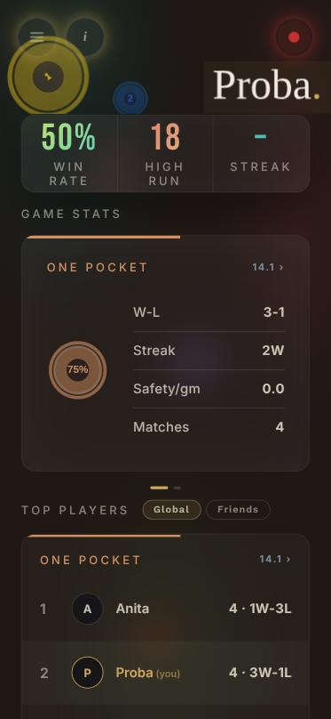
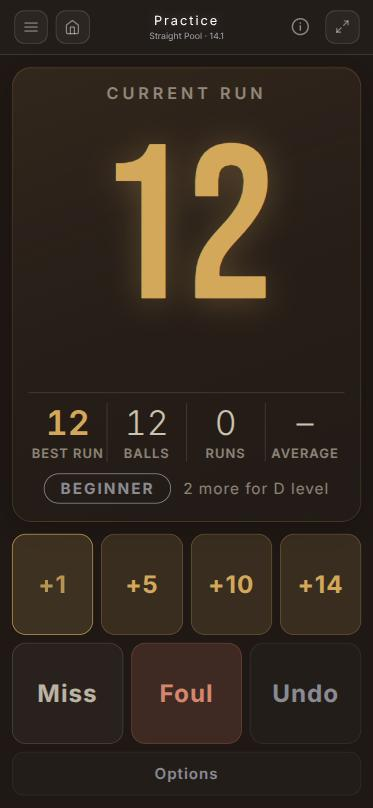
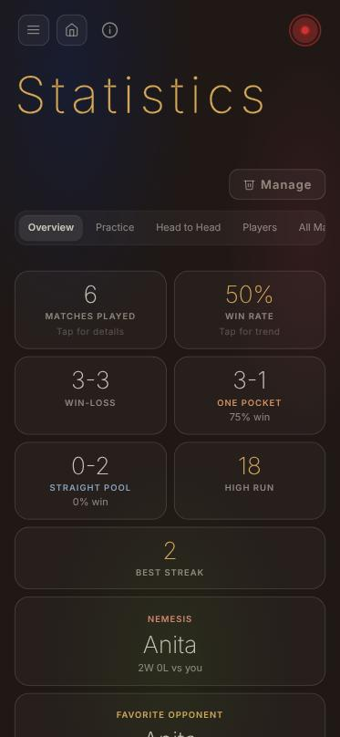
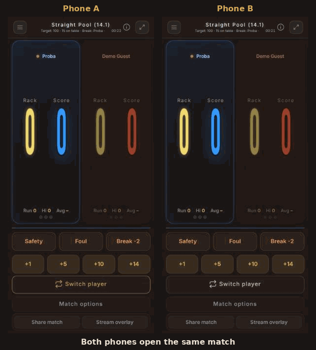

# Chalk & Slate: billiards scoring app

A mobile-first Progressive Web App for scoring **One Pocket** and **14.1 Straight Pool**
matches, with live sync between devices, statistics and a solo practice mode.

**Live:** https://chalkandslate.vercel.app
**Demo account:** available on request

> The source code is private. This repository describes the architecture, the key
> decisions and what I learned. Code samples are available on request.
>
> © 2026 Anita Bezdán. All rights reserved.

> **How it was built:** with AI tools (Claude Code) that I direct. I own the
> requirements, the product, data-model and security decisions, the review, the testing on
> real devices, deployment and operations.


  

**Live sync:** two clients scoring the same match; a point entered on either one
appears on the other within a second or two (recorded in two phone-sized browser windows).



## Why I built it

14.1 and One Pocket have scoring rules that a simple counter cannot follow
(in 14.1 three consecutive fouls cost 15 points, in One Pocket they lose the game
and the turn depends on whose pocket a ball went into), and both players at the table want to see and enter the
score on their own phone. Chalk & Slate handles the rules, syncs the match between
devices and builds statistics from every match and practice session.

## Tech stack

Next.js 16 (App Router), React 19, plain CSS · Supabase (PostgreSQL, Auth,
Realtime, Edge Functions) · Vercel · Sentry · Web Push · Node test runner

```
 Phone / tablet / laptop (PWA)
   │  Next.js App Router pages, client-side React
   │
   ├── Supabase Auth ──────────── sign-up, email confirmation, password reset
   ├── PostgreSQL + RLS ───────── every table protected by row-level security
   │     └── SECURITY DEFINER RPCs ── the only write path for guests
   ├── Realtime (private channels) ── score sync between devices
   └── Edge Functions ─────────── Web Push sending, account deletion
```

## Decisions and trade-offs

**Guests score without an account, through server-side functions.**
Asking an opponent to register before a match would kill the feature, so a shared
link is enough. The first version relied on permissive `USING (true)` policies,
which meant anyone with the public API key could read and write every row. I
replaced them with `SECURITY DEFINER` functions that look up the match from its
code **on the server**, so a client can never write to another match. Match codes
went from an 8-character UUID slice to 22 random characters (~131 bits).

**"Remove from my stats" instead of "request deletion".**
A match between two registered players belongs to both. The original
request/approve deletion flow could not work: under RLS only the creator can
delete. Now each player removes the match from their own statistics only; when
every registered participant has removed it, it is deleted for real.

**Scoring rules as pure functions.**
The rules were first written inside the match page. I moved them into side-effect
free functions so they can be tested without a browser or a database (29 tests).

**No third-party requests from the visitor's browser.**
Fonts and the physics library are self-hosted (GDPR); as a side effect the build no
longer fails when Google Fonts is unreachable.

## What didn't work

**Realtime sync.** Supabase `postgres_changes` subscriptions dropped updates on
phones, especially after the screen locked. The working solution has several
layers: Broadcast from Database on private channels (authorised by RLS),
reconnecting on timeouts and when the tab becomes visible again, and a 3-second
polling fallback, which is what finally made it reliable.

**Scoring on a bad connection.** A failed update set the match state to empty, so
the scoreboard fell back to "Loading…" in the middle of a game. Now every write
goes into a queue that is also kept in local storage: writes are sent in order,
consecutive score changes are merged, a network error keeps the write and retries,
a server rejection drops it, and incoming updates are re-applied on top of the
writes that have not reached the server yet. The last known score is cached, so
the match screen opens even without a connection.

**A security hole I found later.** Two delete functions let any signed-in user wipe
the runs and games of any match, because match codes are readable. I restricted
them to the match creator and checked the fix with a test inside a rolled-back
transaction.

## How I worked

- **Database changes as versioned migrations** (26 so far), applied with the
  Supabase CLI.
- **Security changes tested in rolled-back transactions** against the real schema,
  and the Supabase Security Advisor warnings fixed (`search_path`, removing
  unnecessary `EXECUTE` grants from anonymous users).
- **Testing on real devices:** phone, tablet and laptop, portrait and landscape,
  dark and light theme.
- **Operations:** Sentry error tracking, a database backup script, lint-clean code.

## Other features

Privacy policy and self-service account deletion with anonymisation (the
opponent's history stays intact), push notifications for friend requests, match
invites and feedback replies, installable app with badge and shortcuts, guided tour
on each page, undo for deletions, friends and head-to-head statistics, a TV overlay
for streaming a match.

## Known limitations and next steps

- Dashboard and statistics need a connection to load data; offline, only a match
  or practice session already in progress keeps working (its writes are queued).
- Automated tests cover the scoring rules only; no end-to-end tests yet.
- Next: CI that runs the tests and lint on every push, end-to-end tests for the
  match flow.
